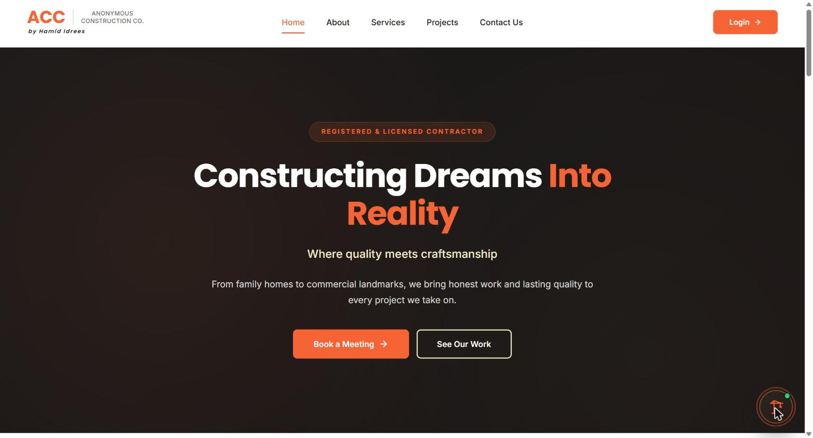
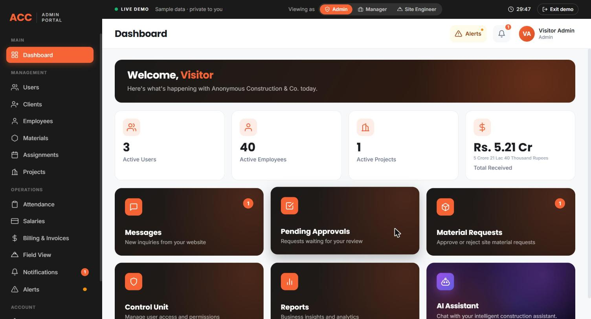
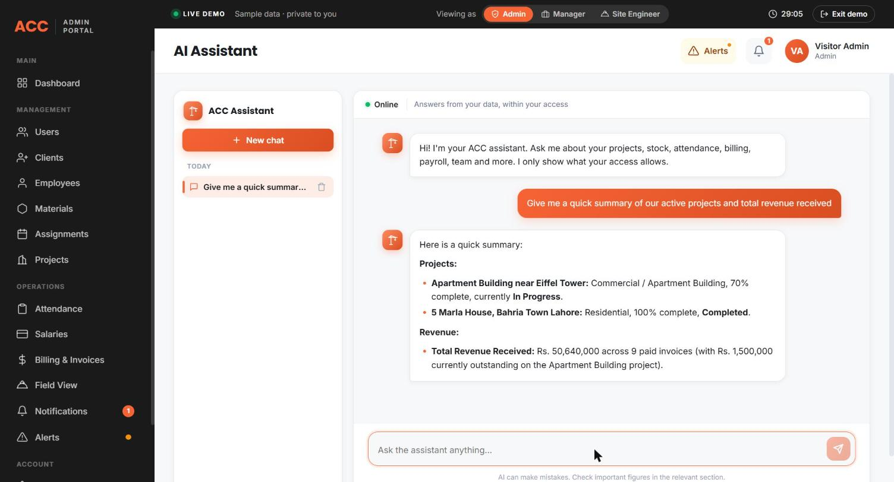
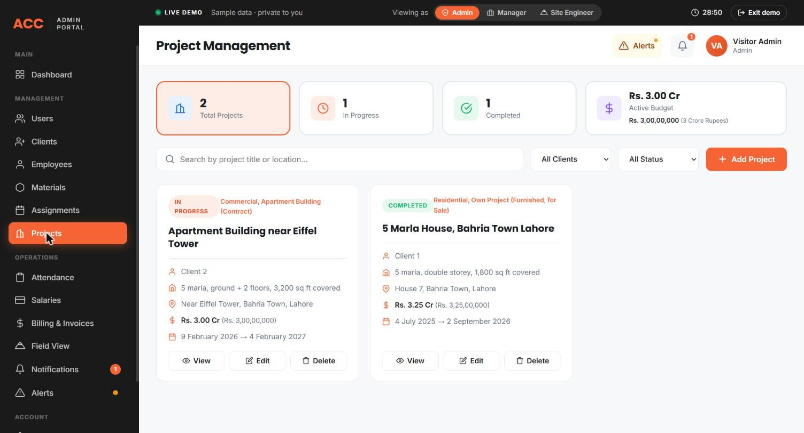
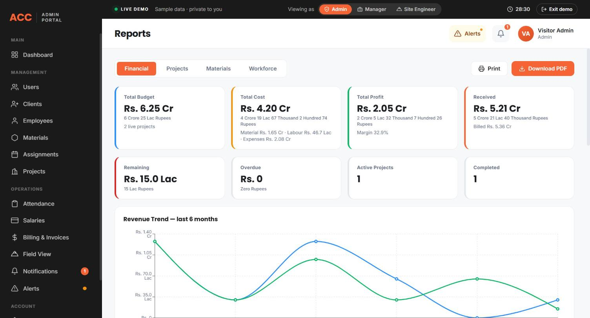

# ACC Platform

A full-stack construction ERP I built from scratch for Anonymous Construction Co., a fictional contracting company based in Lahore. It runs the whole business in one place: projects, site teams, materials, attendance, payroll, invoicing, reporting, and an AI assistant that answers questions from the company's own data. There is also a public marketing website with a chatbot for visitors.

This is my first production project, taken all the way from an empty folder to a live, deployed site.

**Live site:** https://acc.hamididrees.dev
**Try it instantly:** open the site, go to Login, and pick "Login as Visitor". No sign-up. You get a full admin view of a sample company, and your session is private to you and resets after 30 minutes.

## Screenshots

**Public home page**


**ERP dashboard**


**AI assistant answering from live data**


**Projects**


**Reports**


## What it does

The platform has a public side and a signed-in side.

The **public website** is where a potential client lands first: a home page, services, a projects gallery, and a contact form. A chat widget in the corner answers questions about the company (services, how they build, rough costing) and hands off to the team when needed.

The **ERP** is the internal system the company's staff use every day. The main areas:

- **Clients and Employees** - the people the company works with and the people it employs.
- **Projects** - each project has phases, a budget, a site team, and a live financial picture (budget vs. cost vs. profit). Cancelled projects are kept out of the financial totals.
- **Assignments and Attendance** - employees are assigned to projects on daily, monthly, or contract wages, and daily attendance turns into exact labour cost.
- **Salaries** - payroll is calculated on the server from attendance and wages, paid in parts, with a printable payslip. Monthly pay is prorated per day so a mid-month start or wage change is paid correctly.
- **Materials** - inventory with restock and issue history, weighted-average costing, and a block on going into negative stock. Site engineers raise material requests that a manager or admin approves.
- **Billing and Invoices** - line-item invoices with auto numbering, partial payments, and a printable invoice. A phase can quick-fill its agreed client price.
- **Expenses** - company and recoverable project expenses, some billable back to the client.
- **Reports** - financial, project, materials, and workforce reports with charts, built on the same logic as the rest of the system so the numbers always match.
- **Field View** - a stripped-down experience for site engineers, scoped to their own sites, with wages and material costs hidden.

Across all of this there is a **role and permission system** (Control Unit), an **approval workflow** for sensitive actions like deletes, and **live notifications**.

### The AI assistant

There are two assistants, both powered by Google Gemini.

The **public chatbot** answers visitor questions about the company.

The **internal assistant** answers staff questions from the live ERP data, for example "which projects are in progress", "what materials are low on stock", or "show today's attendance". It only ever shows what the signed-in user's permissions allow, and any action it takes goes through the same approval workflow a person would. Tool output is treated as data, never as instructions, so the assistant cannot be talked into doing something through the data it reads.

### Demo mode

Anyone can explore the whole ERP without an account. When a visitor starts the demo, they get their own isolated copy of a fully populated sample company, so they can add, edit, and delete freely without touching anyone else's data. Each visitor's data lives in its own database schema and is cleaned up automatically.

## Tech stack

**Frontend:** React 19 with Vite, React Router, axios, Recharts for the charts, and pdfmake for generating invoices and payslips in the browser.

**Backend:** ASP.NET Core (.NET 10) Web API in C#, built in n-tier layers (Controllers, Services, Repositories) on top of Entity Framework Core.

**Database:** PostgreSQL, hosted on Neon.

**Auth and real-time:** JWT authentication with role and permission checks, BCrypt password hashing, and SignalR for live updates and notifications.

**AI:** Google Gemini, called through a backend client that uses tool calling (the model calls the app's own services to read data and draft actions) and structured output, with retries and rate limits.

**Hosting:** the frontend is on Vercel, the backend runs as a Docker container on Render, and the database is on Neon. All three are in the same US region so the app stays fast.

## Architecture notes

A few decisions I want to call out, since they were the interesting parts to build:

**Clean layering.** Controllers only handle the request and response. Services hold the business rules (payroll proration, weighted-average costing, invoice status). Repositories talk to the database. This keeps the money logic in one place and reusable, which is why the Reports module can show the same numbers as the Billing and Salary pages.

**Multi-tenant demo.** The demo originally gave each visitor a separate database. When I moved to Postgres on Neon's free tier (one database, unlimited schemas), I reworked it so each visitor gets their own schema inside the one database instead. The app reads the active schema from the connection string and caches a separate EF model per schema. The result is full isolation between visitors with almost no extra cost.

**Server-authoritative money.** Nothing financial is trusted from the client. Salaries, invoice totals, and material costs are all computed on the server, under per-record locks so two quick clicks can never double-pay or oversell stock.

**AI with guardrails.** The assistant uses the signed-in user's own permissions, logs what it does, is rate limited for demo visitors, and routes any real action through human approval. API keys live in secrets, never in the code.

## Running it locally

You need the .NET 10 SDK, Node.js, and a PostgreSQL database (a free Neon database works).

```bash
# clone
git clone https://github.com/Hamid-Idrees-7/ACC-Platform.git
cd ACC-Platform

# backend
cd Backend
dotnet user-secrets set "ConnectionStrings:DefaultConnection" "<your Postgres connection string>"
dotnet ef database update
dotnet run --launch-profile https

# frontend
cd Frontend
npm install
npm run dev
```

On first run the backend seeds a single admin account so you can sign in right away. The username and password come from configuration (`Seed:AdminUsername` and `Seed:AdminPassword`), with simple defaults for local development.

### Configuration

Secrets are never committed. Locally they go in .NET user-secrets; in production they are set as environment variables on the host. The main ones:

- `ConnectionStrings__DefaultConnection` - the Postgres connection string
- `Jwt__Key` - a signing key, at least 32 characters
- `Ai__ApiKey` - a Google Gemini API key
- `App__FrontendUrl` - the website origin, for CORS
- `Seed__AdminUsername` and `Seed__AdminPassword` - the first admin
- `Email__*` - SMTP settings for password-reset emails

The frontend reads one variable, `VITE_API_ORIGIN`, which points at the backend.

## Status

The platform is live and in active development. The core system, the public site, the demo, and both AI assistants are done. Next up is a custom domain and a portfolio page with the full case study.

## Author

Built by Hamid Idrees, a software engineering student.
